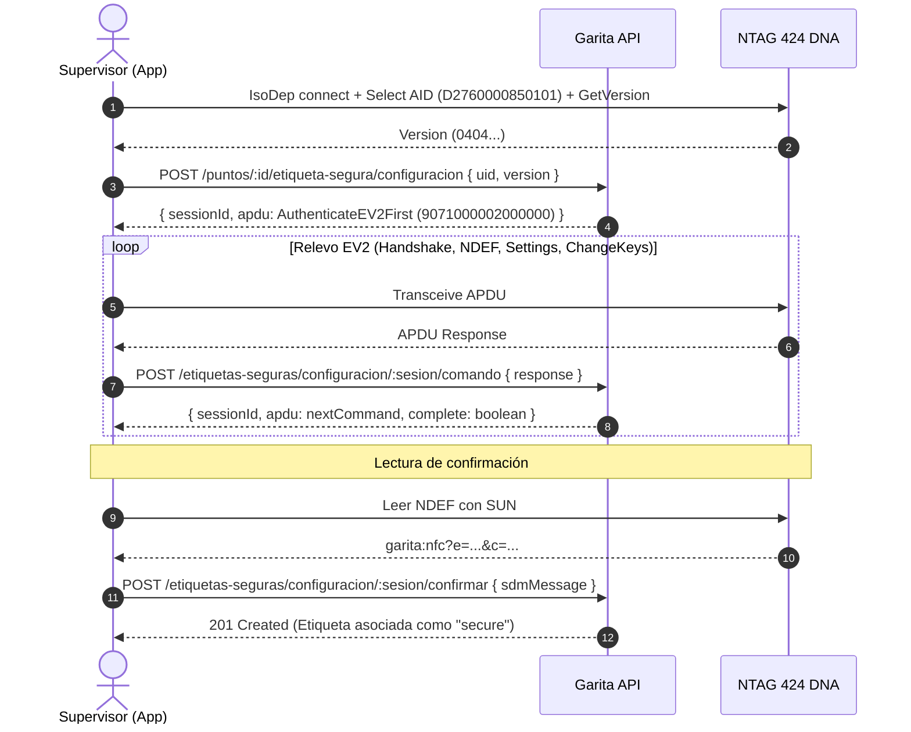

# Etiquetas NFC seguras (HU-38)

El módulo de etiquetas NFC seguras incorpora soporte para transpondedores criptográficos NTAG 424 DNA (conviviendo con etiquetas básicas de solo UID de HU-07 y HU-12). Su propósito es prevenir el clonado de identificadores de fábrica y la reproducción de lecturas en puntos de control críticos.

## 1. Convivencia de tipos y modelo de datos

El sistema admite dos tipos de etiquetas:

- `basic`: identificada únicamente por su UID de fábrica de 7 bytes (HU-07).
- `secure`: basada en NTAG 424 DNA, configurada con claves maestras diversificadas y modo SUN (Secure Dynamic Messaging). En cada aproximación genera una URL NDEF firmada criptográficamente con un contador incremental.

### Modificaciones en el esquema de persistencia (Prisma)

- **`NfcTag`**:
  - `kind`: enum `NfcTagKind` (`basic`, `secure`), por defecto `basic`.
  - `configurationStatus`: enum `NfcTagConfigurationStatus` (`none`, `incomplete`, `configured`).
  - `masterKeyVersion`: número entero que registra la versión de la clave maestra con la que fue inicializada la etiqueta.
  - `lastCounter`: valor entero del último contador SDM validado (utilizado para detección anti-replay).
- **`SecureTagSession`**:
  - Registra las sesiones efímeras de configuración por relevo (`id`, `companyId`, `tagUid`, `checkpointId`, `step`, `state`, `expiresAt`, `createdById`).
  - Filtrada automáticamente por empresa y predio asignado mediante `tenantPrisma`.
  - Expira en 2 minutos para evitar sesiones zombi.
- **`CheckpointRecord`**:
  - `sdmMessage`: cadena con el mensaje NDEF recibido (`garita:nfc?e=...&c=...`).
  - `sdmResult`: enum `SdmResult` (`valid`, `invalid_signature`, `missing`, `replayed`).

---

## 2. Gestión de claves y criptografía en el servidor (ID-172)

Toda la criptografía se ejecuta en el servidor en `apps/api/src/modules/nfc-tags/secure/` utilizando exclusivamente `node:crypto`, cumpliendo con NIST SP 800-38B, NIST SP 800-108 y los estándares de NXP (AN12196, AN10922 y NT4H2421Gx).

### Clave maestra y política de resguardo

- `NFC_MASTER_KEY`: secreto de 16 bytes (32 caracteres hexadecimales) configurado en variables de entorno del servidor.
- `NFC_MASTER_KEY_VERSION`: versión numérica entera (ej. 1).
- **Resguardo**: la clave maestra debe custodiarse en un gestor de secretos seguro (ej. Doppler, AWS Secrets Manager, Vault) con respaldo desconectado (offline backup). Si la clave maestra se pierde, ninguna etiqueta segura de esa versión podrá ser verificada ni reconfigurada.
- **Rotación**: para rotar la clave maestra, se incrementa `NFC_MASTER_KEY_VERSION` y se actualiza la clave en el servidor. Las etiquetas existentes mantienen su `masterKeyVersion` anterior hasta que sean reasociadas o restablecidas.
- **Confidencialidad en logs**: nunca se imprimen ni registran en consola claves maestras, claves diversificadas, claves de sesión ni payloads completos que expongan criptogramas de sesión.

### Derivación de claves por etiqueta (KDF)

Siguiendo NIST SP 800-108 en modo contador con PRF CMAC-AES-128 (AN10922):

- Entrada: `NFC_MASTER_KEY`, UID de la etiqueta (7 bytes), número de slot de clave (0 a 4) y versión de clave (1 byte).
- Contexto de diversificación: `[UID || Slot || Versión]`.
- Cada etiqueta posee sus propias 5 claves AES independientes; conocer la clave de una etiqueta no compromete a ninguna otra etiqueta de la empresa ni del sistema.

### Verificación del mensaje dinámico SUN (AN12196)

El NDEF generado por la etiqueta apunta a un esquema de URI `garita:nfc?e=<PICCData_Hex>&c=<MAC_Hex>`:

1. **PICCData**: descifrado con AES-128-CBC (IV = 16 ceros) usando la clave meta (Slot 2 diversificada). Contiene el byte de encabezado `0xC7`, el UID de 7 bytes, el contador SDM de 3 bytes (little-endian) y relleno.
2. **Clave de sesión SDM**: derivada mediante AES-128-CMAC usando la clave de lectura MAC (Slot 1 diversificada) y los datos `3CC300010080 || UID || SDMReadCtr`.
3. **Firma truncada**: cálculo de CMAC con la clave de sesión y truncado a 8 bytes según NT4H2421Gx (bytes de índice impar 1, 3, 5, 7, 9, 11, 13, 15).
4. **Comparación en tiempo constante**: `crypto.timingSafeEqual` para prevenir ataques de canal lateral (timing attacks).
5. **Rendimiento**: la verificación criptográfica completa toma menos de 2 ms (muy por debajo del límite de 50 ms exigido).

---

## 3. Configuración por relevo de comandos (ID-173 e ID-175)

La app móvil nunca recibe ni almacena la clave maestra ni las claves derivadas. Actúa como un puente transparente (relevo) de tramas APDU entre la API y la etiqueta vía ISO/IEC 7816-4 / IsoDep.



### Pasos de la sesión de relevo

1. **`AuthenticateEV2First`** (Paso 1 y 2): autenticación mutua con la clave de fábrica (o clave diversificada previa en caso de reconfiguración) generando `ti` (Transaction Identifier) y claves de sesión de cifrado y MAC.
2. **`WriteFile` NDEF**: escritura del registro NDEF URI tipo 4 con plantilla que reserva espacio para los espejos de PICCData y CMAC.
3. **`ChangeFileSettings`**: configuración de los permisos del archivo NDEF activando el Secure Dynamic Messaging (SDM), fijando la clave 2 como MetaKey, la clave 1 como FileReadKey y los offsets exactos del URI.
4. **`ChangeKey`**: actualización sucesiva de las claves 1, 2, 3, 4 y 0 con las claves diversificadas calculadas por el servidor.
5. **`Confirmar`**: lectura de prueba obligatoria; el servidor verifica el SUN contra las nuevas claves. Al ser válido, la etiqueta pasa a estado `configured` y `kind: secure`.

### Manejo de interrupciones y etiquetas de otras empresas

- **Interrupción**: si el usuario aleja el celular durante el proceso, la sesión expira y el registro de etiqueta permanece como `configurationStatus: incomplete`, indicando en la pantalla: _"La configuración no se completó. Volvé a acercar el celular"_.
- **Aislamiento inter-empresa**: si una etiqueta segura fue asociada previamente por otra empresa, la API responde `422 Unprocessable Entity` con el mensaje neutro _"Etiqueta no disponible"_, impidiendo cualquier filtración de datos de propiedad.
- **Restablecimiento**: una etiqueta retirada de un punto de la misma empresa puede restablecerse vía `POST /api/v1/etiquetas-seguras/:id/restablecer` para volver a asociarla a otro punto.

---

## 4. Marcas criptográficas en rondas (ID-174)

Al leer un punto de control durante un turno, el vigilador escanea la etiqueta NFC. La app extrae tanto el UID de fábrica como el mensaje dinámico NDEF SUN (si existe).

En la API, el evaluador de marcas (`MarcasService`) verifica el registro:

- **`tag_not_authentic` (Grave)**:
  - Se genera si el punto tiene una etiqueta activa configurada como `secure`, pero el registro recibido no incluye mensaje dinámico (ej. alguien intentó usar una tarjeta básica clonada con el mismo UID).
  - Se genera si el mensaje dinámico contiene una firma CMAC inválida, encabezado corrupto o UID inconsistente con el de la etiqueta.
- **`replayed_read` (Grave)**:
  - Se genera si el contador `SDMReadCtr` extraído del PICCData es menor o igual al `lastCounter` persistido en la etiqueta (ej. alguien grabó un mensaje anterior e intentó reproducirlo con un emulador o retransmitir una petición capturada).
- **Lectura sin señal (Modo offline, CA5)**:
  - En predios sin cobertura, los registros se encolan localmente en SQLite con su `sdmMessage`.
  - Al recuperar señal, el lote se transmite a `POST /api/v1/sincronizacion/eventos`. Cada registro es verificado y procesado de forma idéntica, actualizando el contador y aplicando las marcas correspondientes sin rechazar el evento.

---

## 5. Endpoints de la API y control de acceso

| Método | Ruta                                                         | Roles                          | Descripción                                                       |
| ------ | ------------------------------------------------------------ | ------------------------------ | ----------------------------------------------------------------- |
| `POST` | `/api/v1/puntos/:id/etiqueta-segura/configuracion`           | `admin`, `supervisor`          | Inicia la sesión de relevo para un punto asignado.                |
| `POST` | `/api/v1/etiquetas-seguras/configuracion/:session/comando`   | `admin`, `supervisor`          | Procesa la respuesta de la etiqueta y devuelve el siguiente APDU. |
| `POST` | `/api/v1/etiquetas-seguras/configuracion/:session/confirmar` | `admin`, `supervisor`          | Valida la lectura de prueba y asocia la etiqueta como `secure`.   |
| `POST` | `/api/v1/etiquetas-seguras/:id/restablecer`                  | `admin`, `supervisor`          | Prepara una etiqueta retirada para su reasociación.               |
| `POST` | `/api/v1/registros-puntos`                                   | `guard`, `supervisor`, `admin` | Registra el paso por el punto con soporte para `sdmMessage`.      |
| `POST` | `/api/v1/sincronizacion/eventos`                             | Credencial de turno            | Procesa lotes sin señal evaluando marcas criptográficas.          |

---

## 6. Configuración nativa en la App móvil (ID-175 e ID-176)

### Identificador de aplicación iOS (AID)

En `apps/mobile/app.config.ts`, la clave `infoPlist` incluye la propiedad:

```json
{
  "com.apple.developer.nfc.readersession.iso7816.select-identifiers": ["D2760000850101"]
}
```

Esto habilita a iOS CoreNFC a comunicarse con el canal ISO 7816-4 de NTAG 424 DNA.

### Recomendación operativa: cuándo usar etiquetas seguras

Las etiquetas NTAG 424 DNA tienen un costo unitario superior al de las etiquetas convencionales MIFARE Ultralight / NTAG 213. Se recomienda:

1. **Puntos exteriores y perimetrales**: utilizar etiquetas NTAG 424 DNA anti-metal. Estos puntos presentan mayor riesgo de intentos de clonado remoto o simulación de rondas.
2. **Puntos interiores de paso frecuente**: pueden utilizar etiquetas básicas (UID) o códigos QR protegidos por la presencia de vigiladores en garita.

## Correcciones de configuracion y recuperacion (auditoria WD)

Una etiqueta `configured` con `masterKeyVersion` vigente pasa directamente a la lectura de prueba, tanto si estaba activa en ese punto como retirada o reemplazada. Restablecer una etiqueta retirada la marca `incomplete` y obliga a reconfigurarla. Una version distinta responde 409: queda pendiente un keyring para recuperar claves maestras anteriores; no se sobrescribe esa version ni se intenta usar la maestra actual como si fuera la anterior.

La recuperacion comienza con fabrica en slot 0. Solo `91AE` en `auth_2` inicia otra autenticacion con la derivada vigente. En ambos casos se reescriben NDEF y ajustes. Para slots 1 a 4, `ChangeKey` usa `(newKey XOR oldKey) || version || CRC32(newKey)`; el CRC no lleva complemento final ([NXP AN12196, tabla 25](https://www.nxp.com/docs/en/application-note/AN12196.pdf)). Primero se prueba fabrica; ante `911E` se inicia una nueva autenticacion EV2 y se reintenta ese slot una sola vez con la derivada. El contador EV2 reinicia en cero y luego avanza por comando confirmado. El relevo admite hasta 23 respuestas, incluyendo cuatro reautenticaciones y el fallback inicial de slot 0.

Confirmar verifica el SUN contra `lastCounter` persistido y actualiza con comparacion atomica de ese valor previo. Una lectura repetida o una carrera no puede retroceder el historico. La baja del punto o del predio retira sus etiquetas activas, conservando claves e historico; un punto fijado en un turno en curso no puede darse de baja.

### Prueba manual pendiente con etiqueta real (Android)

- [ ] Configurar una etiqueta nueva y confirmar SUN; repetir la lectura y comprobar rechazo de replay.
- [ ] Interrumpir antes de `key_0`, incluyendo despues de cada slot 1 a 4; volver a acercar y completar.
- [ ] Interrumpir despues de `key_0` y antes de confirmar; recuperar con la clave derivada.
- [ ] Retirar y reasociar en otro punto; comprobar que no reconfigura sin reset y conserva contador.
- [ ] Restablecer una retirada y comprobar reconfiguracion completa y lectura de prueba.
- [ ] Probar etiqueta basica, UID invalido y GetVersion no compatible; verificar feedback y fallback.
- [ ] Retirar una NTAG 424 DNA durante la deteccion; verificar que pide volver a acercarla y no la asocia como basica.
- [ ] Durante lectura, comprobar botones y cambio de predio bloqueados; probar red alcanzable desconocida y sin conexion.

Estas pruebas requieren hardware y no fueron ejecutadas por la auditoria automatizada.
